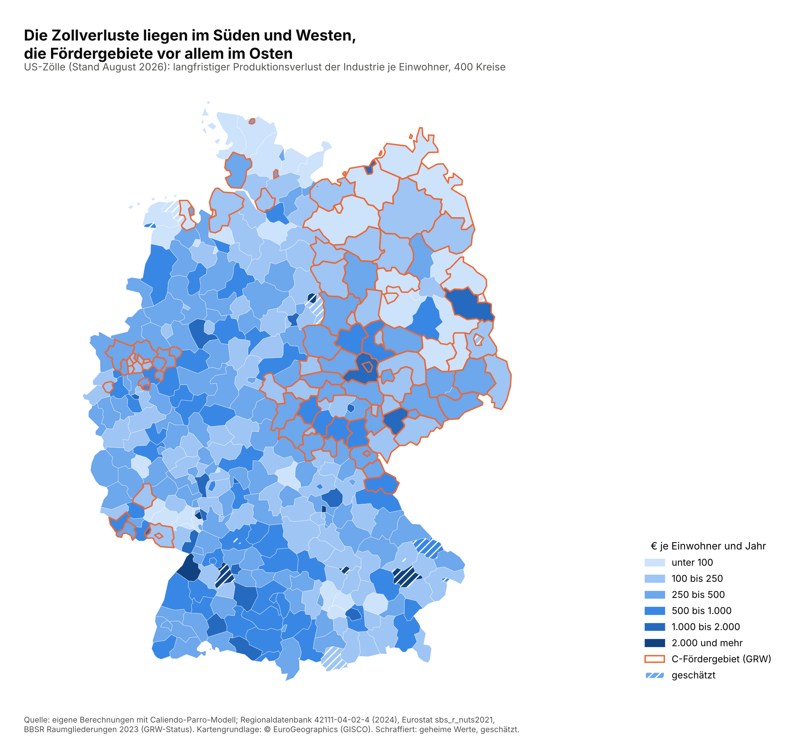
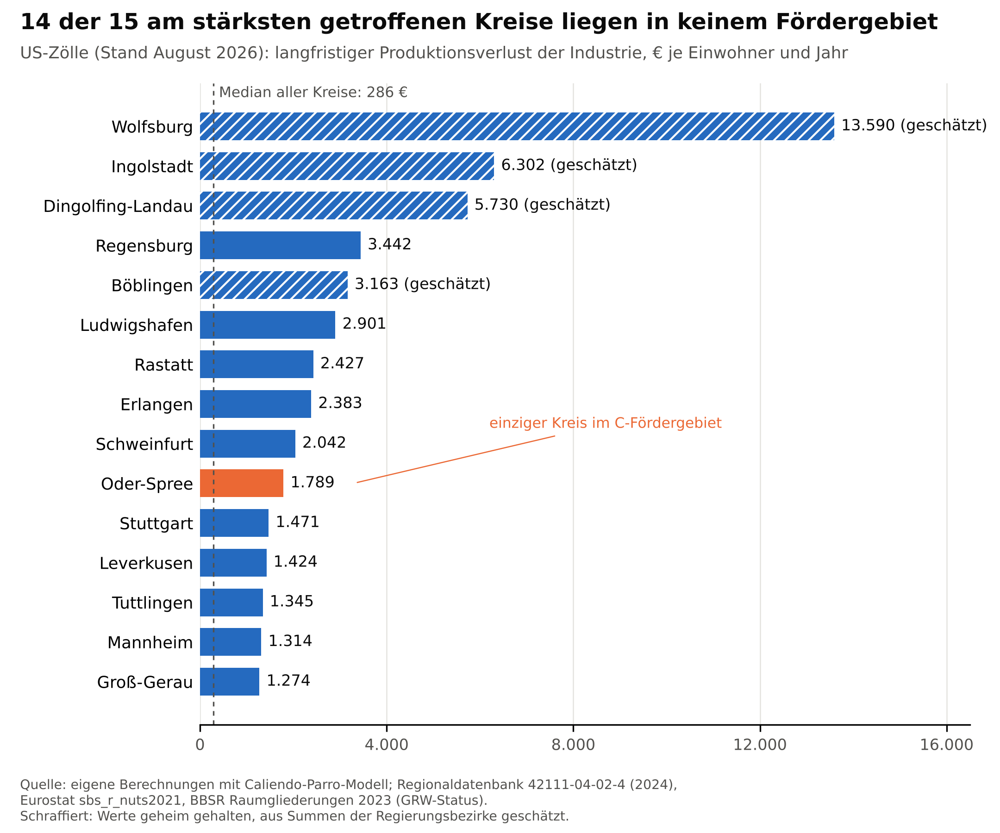

Die US-Zölle kosten die deutsche Industrie auf Dauer rund 34 Mrd. EUR Produktion im Jahr. Das sind 1,6 % ihres Umsatzes. Der Verlust verteilt sich sehr ungleich. Ein Fünftel der Kreise trägt die Hälfte davon.

Die Zahlen stammen aus einem Handelsmodell. Es rechnet aus, wie stark jede Industriebranche unter den Zöllen vom August 2026 schrumpft. Dazu kommen amtliche Daten zu Branchen und Exporten in jeder Region. So lässt sich der Verlust auf alle 400 Kreise verteilen.

Am stärksten trifft es die Autostandorte. Je Einwohner führen Wolfsburg, Ingolstadt und Dingolfing-Landau. Deren Werte hält die Statistik geheim. Wir haben sie aus den Summen der Regierungsbezirke geschätzt. Mit diesen Kreisen steigt der Verlust auf 38 Mrd. EUR. Unter den Kreisen mit veröffentlichten Daten führen Regensburg, Ludwigshafen, Rastatt und Erlangen.

Die betroffenen Kreise sind reich. Im obersten Fünftel liegt die Wirtschaftsleistung je Einwohner gut 60 % höher als im untersten. Die Arbeitslosigkeit ist dort niedriger.

Das hat einen einfachen Grund: Dort steht die Industrie. Jeder Schock für die Industrie träfe fast dieselben Orte. Ein gleich großer Rückgang in allen Kreisen ergäbe beinahe dieselbe Rangfolge. Die Zölle verschärfen das Bild nur leicht. Sie treffen exportstarke Städte mit hohen Löhnen etwas härter.

Das hat Folgen für die Politik. Die Regionalförderung GRW unterstützt strukturschwache Gegenden. Dort fallen nur 13 % des Verlusts an. Unter den 15 am stärksten getroffenen Kreisen liegt nur Oder-Spree in einem Fördergebiet. Die Förderung erreicht die betroffenen Orte also kaum. Das liegt nicht am Zuschnitt der Förderkarte. Sie soll schwache Regionen stützen, und die Zölle treffen starke.

Für die Gemeinden zählt vor allem die Gewerbesteuer. Sie hängt an den Gewinnen der Betriebe. In den betroffenen Kreisen bringt sie doppelt so viel je Einwohner wie anderswo. Der Ausfall liegt bei 0,3 bis 1,2 Mrd. EUR im Jahr. Das ist ein Bruttowert. Der kommunale Finanzausgleich verteilt Geld zwischen armen und reichen Gemeinden. Er dämpft den Verlust aber vor allem in schwachen Gemeinden. Starke Industriestädte tragen ihren Ausfall weitgehend selbst.

Heikel wird es in 26 Kreisen. Dort trifft der Zollverlust auf ein zweites Problem. Entweder schrumpft die Bevölkerung, z.B. in Zwickau und dem Saalekreis. Oder viele Menschen leben von Grundsicherung, z.B. in Ludwigshafen und Krefeld. Elf dieser Kreise liegen in keinem Fördergebiet.

Zwei Einschränkungen gelten. Die Zahlen beschreiben einen Zustand auf lange Sicht, keine Prognose für nächstes Jahr. Und ob die Kreise wirklich so verlieren, zeigt erst der Abgleich mit den Daten für 2025.
