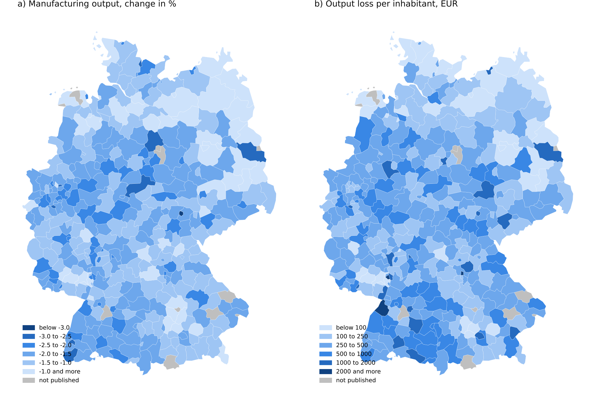
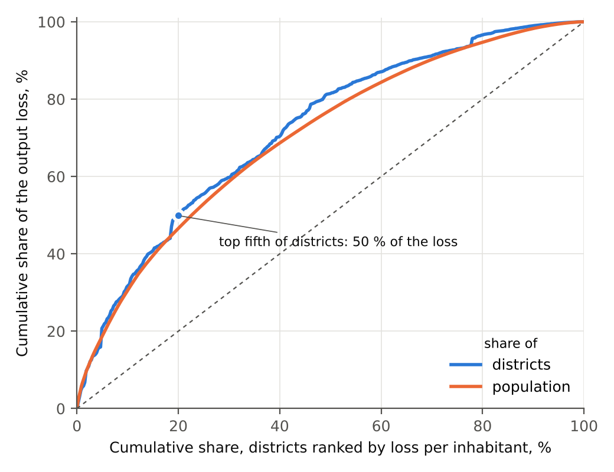
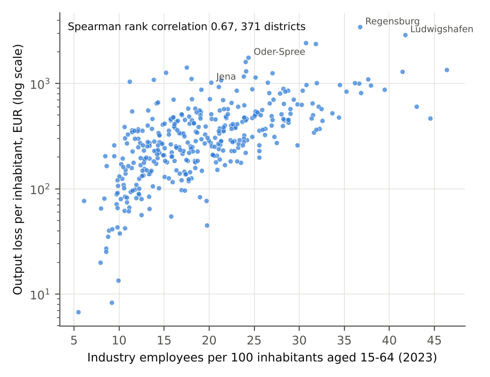
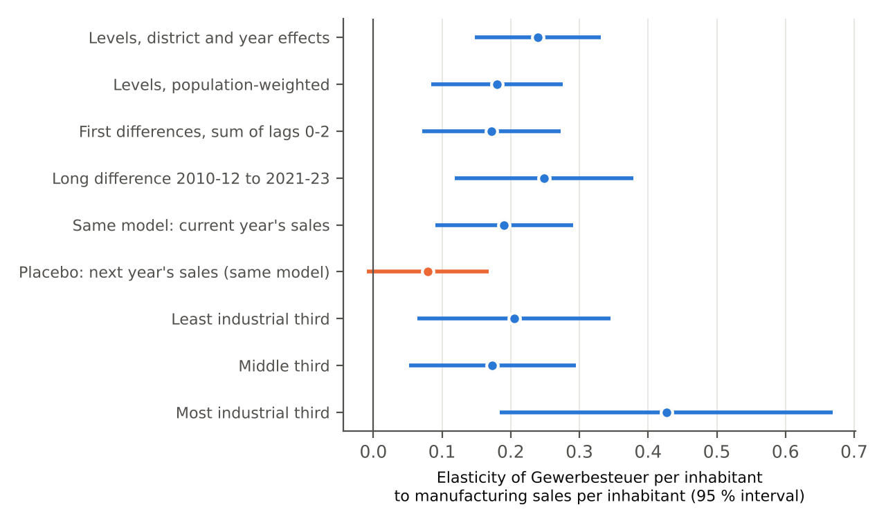

**Disclaimer.** The views expressed are the author's own and do not necessarily reflect those of any institution. All errors are the author's.

**JEL classification.** F13, F14, R12, H71.

**Availability.** District maps and tables: <https://wfhungerland.github.io/tradepolicy-site/#kreise>. Scripts are referred to by number (for example script 74); Appendix B lists them.

# 1 Introduction

Since 2025 the United States has levied much higher tariffs on imports from the European Union. In August 2026, after the Supreme Court ruling against the tariffs imposed under the International Emergency Economic Powers Act, the remaining measures are mainly Section 232 tariffs on steel, aluminium, copper, cars, trucks, semiconductors and pharmaceuticals, and Section 301 tariffs. Their aggregate cost for Germany is small: in a multi-sector general equilibrium model the tariffs lower German real income by about 0.07 % in the long run (Hungerland 2026). Aggregate numbers hide where the cost falls. That distribution decides which labour markets, municipal budgets and policy instruments the shock reaches.

This paper allocates the manufacturing output loss to Germany's 400 districts and links it to district data on prosperity, labour markets, municipal finances, demography and regional aid. It makes three contributions. First, it combines a structural trade model with official district statistics in a transparent downscaling, and tests the downscaling against seven alternative rules. Second, it estimates how strongly local business tax responds to district-specific changes in manufacturing sales, and uses the estimate to quantify the fiscal channel. Third, it compares the exposure with the map of regional aid areas.

The main result is that the tariff shock is a shock to strong regions. The most exposed fifth of districts is richer, more industrial and younger than the rest, with lower unemployment. The loss correlates with industry employment per working-age inhabitant (Spearman rank correlation 0.67), with GDP per head (0.47) and earnings (0.42), not with unemployment (−0.10). Regional aid in Germany targets other places. The fiscal hit through local business tax is real but small, and it is concentrated in fiscally strong municipalities. A minority of 26 districts combines high exposure with a second risk, shrinking population or high welfare dependency; they are the natural focus for policy.

# 2 Related literature

The literature on regional effects of trade shocks has mostly studied import competition. Autor, Dorn and Hanson (2013) show that Chinese import competition depressed employment and wages in exposed US commuting zones for a decade. For Germany, Dauth, Findeisen and Suedekum (2014) find that the rise of China and Eastern Europe was on balance positive: export gains in some regions outweighed import losses in others. Dippel et al. (2022) link import competition in German regions to votes for parties at the right margin.

Export shocks have received less attention. Fajgelbaum et al. (2020) show for the 2018 US tariffs that retaliatory tariffs hit agricultural counties in the United States hardest. An export shock falls where exporting industry is located; in Germany that means the prosperous manufacturing regions that gained from earlier trade integration.

Methodologically, the paper uses a shift-share design. Goldsmith-Pinkham, Sorkin and Swift (2020) and Borusyak, Hull and Jaravel (2022) discuss when such designs identify causal effects. Here the design is used for measurement, not identification: the shifts come from a structural model (Caliendo and Parro 2015), solved in changes (Dekle, Eaton and Kortum 2008), and the shares from official statistics. Associations between exposure and district characteristics are descriptive.

# 3 Data

The model is calibrated on the OECD inter-country input-output tables for 2022 (OECD 2025), 81 economies and 50 sectors, with US applied tariffs by origin and product from the CEPII database (Guimbard 2026). Regional industry structure comes from Eurostat's structural business statistics by NUTS 2 region (sbs_r_nuts2021, persons employed by NACE division, latest year 2021 to 2023).

District data come from three official sources. The Regionaldatenbank Deutschland, table 42111-04-02-4, gives sales and foreign sales of manufacturing and mining establishments with 20 and more employees by district, 2009 to 2024. Foreign sales are direct sales to customers abroad; deliveries to German exporters count as domestic. Values are suppressed where few establishments would be identifiable. In 2024, 386 of 400 districts are published, with 82.1 million of 83.6 million inhabitants. The 14 suppressed districts include large car-making locations (Wolfsburg, Ingolstadt, Dingolfing-Landau, Böblingen, Heilbronn city, Emden), so the totals understate the loss.

INKAR 2025 (BBSR 2025) provides district indicators for 2023 and earlier years: GDP per head, earnings, industry employment, unemployment, population projections to 2045, welfare (SGB II) rates, election results, and Gewerbesteuer receipts and tax capacity per inhabitant since 1995. The BBSR reference file for the regional aid map 2022 to 2027 gives the GRW status of every municipality. Appendix Table A1 lists all sources.

# 4 Method

## 4.1 Output change by industry

A Caliendo-Parro model with input-output links gives the long-run change in German output for each of the model's manufacturing sectors when US tariffs move from their level of 1 January 2025 to that of 22 August 2026. Tariff revenue is rebated, trade deficits are held fixed and there is no retaliation in the central scenario. Trade elasticities are sector medians of ProTEE (Fontagné, Guimbard and Orefice 2022), capped at 15. The companion methods paper documents the model, its validation and its sensitivity (Hungerland 2026).

## 4.2 Regional shock

Each NUTS 2 region r receives the employment-weighted mean of the industry output changes,

```{=html}
<p class="formula">m<sub>r</sub> = &Sigma;<sub>s</sub> (L<sub>rs</sub> / L<sub>r</sub>) &middot; &Delta;Y<sub>s</sub>,</p>
```

where L~rs~ is employment in manufacturing division s and ΔY~s~ the model's output change in per cent. Across the 38 German regions m~r~ ranges from −0.8 % to −2.0 % (median −1.7 %). Regions with metal, car and machinery industries lose most: Arnsberg (−2.0 %), Braunschweig (−2.0 %) and the Saarland (−1.9 %); Hamburg loses least (−0.8 %).

## 4.3 Allocation to districts

Within a region the industry mix of districts is not published. Districts therefore inherit the mix of their region, and the shock is scaled by the district's export ratio relative to the region's:

```{=html}
<p class="formula">&Delta;Y<sub>k</sub> = m<sub>r</sub> &middot; q<sub>k</sub> / q<sub>r</sub>, &nbsp;&nbsp; V<sub>k</sub> = &minus;&Delta;Y<sub>k</sub> &middot; U<sub>k</sub>,</p>
```

where q~k~ is foreign over total sales of district k in 2024, q~r~ the same for its region, U~k~ manufacturing sales and V~k~ the output loss in euro. The scaling assumes that, given the regional mix, the loss is proportional to sales abroad. It keeps regional totals: summed over districts, the loss equals m~r~ times regional sales. Section 9 tests the assumption.

The approach rests on three simplifications. The district industry mix is that of its region. Foreign sales cover all destinations, so the shock assumes the national destination mix. And the result is a static long-run effect of the first round: it holds employment and capital in place within Germany and has no spillovers between districts through supply chains or commuting.

# 5 Where the losses fall

German manufacturing loses EUR 34.0 billion of output a year, 1.6 % of the EUR 2,064 billion sales of establishments with 20 and more employees in the published districts. By district, output falls by 0.3 % to 3.5 % (median 1.5 %). In per cent, districts with very high export ratios lead: Jena (−3.5 %), Landshut city (−3.3 %) and Oder-Spree (−3.0 %). Per inhabitant, locations of large plants in the car, chemical and supplier industries lead: Regensburg city (EUR 3,440), Ludwigshafen (2,900), Rastatt (2,430), Erlangen (2,380) and Schweinfurt city (2,040), against a median of EUR 290 (Figure 1).



The loss is concentrated. The most exposed fifth of districts carries 50 % of it, the least exposed fifth 3 % (Figure 2). Weighted by population the curve is almost the same, so the concentration does not come from small districts.

{width=70%}

# 6 Who is exposed

Splitting the districts into five groups of equal size by loss per inhabitant shows a clear profile (Table 1). The most exposed fifth (Q5) has a GDP per head of EUR 61 thousand against 37 thousand in the least exposed fifth (Q1), median earnings 20 % higher, almost twice the industry employment rate, a younger population and lower unemployment. Across all districts the loss correlates most with industry employment per working-age inhabitant (Figure 3).

**Table 1: Profile of districts by exposure to US tariffs (quintiles of loss per inhabitant)**

| Indicator (population-weighted mean) | Q1 | Q2 | Q3 | Q4 | Q5 |
| --- | ---: | ---: | ---: | ---: | ---: |
| Output loss per inhabitant, EUR | 94 | 192 | 310 | 438 | 919 |
| GDP per head, EUR thousand (2022) | 37.2 | 40.5 | 44.3 | 44.7 | 60.6 |
| Median full-time earnings, EUR per month | 3,420 | 3,683 | 3,768 | 3,677 | 4,104 |
| Industry employees per 100 aged 15-64 | 12.0 | 14.2 | 16.7 | 20.7 | 22.6 |
| Employees with university degree, % | 14.4 | 18.9 | 17.0 | 15.4 | 20.9 |
| Unemployment rate, % | 6.0 | 6.2 | 5.9 | 5.1 | 5.5 |
| Mean age, years | 45.2 | 44.3 | 44.3 | 44.4 | 43.5 |
| Population change 2013-2023, % | 3.6 | 3.4 | 3.3 | 3.3 | 3.7 |
| AfD party-list vote 2025, % | 23.2 | 19.6 | 20.2 | 21.8 | 18.7 |

Source: BBSR (2025), INKAR; own calculations. Indicators 2023 unless stated.

{width=70%}

Regressions with Land fixed effects, robust standard errors and standardised regressors (script 79) confirm the pattern. The share of Gewerbesteuer in municipal tax capacity rises by 2.7 percentage points per standard deviation of exposure (p = 0.007), controlling for earnings and density. The AfD gained more votes between 2017 and 2025 in more exposed districts (+0.74 points per standard deviation, p < 0.001, 369 districts, controlling for unemployment, earnings, age and density). The tariffs of 2026 cannot explain earlier votes; the measure stands for export-oriented industrial sites, not a causal effect. The level of the AfD vote in 2025 is unrelated to exposure (rank correlation −0.01).

Several expected links are absent. Neither the change in the export ratio since 2019 nor the energy intensity of the regional industry mix explains where industry employment fell between 2019 and 2023. Unemployment is slightly lower in exposed districts (5.5 % against 6.0 %), but INKAR has no vacancy totals that would show whether displaced workers would find new jobs locally.

# 7 Local business tax

## 7.1 The channel

Gewerbesteuer is the main own tax of German municipalities, EUR 73 billion in 2023. Its base is business profit with add-backs; for firms with plants in several municipalities it is apportioned by payroll (§ 29 GewStG). Prepayments follow the last assessment, so receipts react with a lag. In the most exposed fifth of districts Gewerbesteuer brings EUR 1,269 per inhabitant, twice as much as in the least exposed fifth (EUR 599), and 80 % of tax capacity against 60 %.

## 7.2 Elasticity

To translate output into tax, the paper estimates the elasticity of Gewerbesteuer per inhabitant to manufacturing sales per inhabitant in a district panel for 2009 to 2023 (script 87):

```{=html}
<p class="formula">ln G<sub>kt</sub> = &beta; ln U<sub>kt</sub> + &alpha;<sub>k</sub> + &delta;<sub>t</sub> + &epsilon;<sub>kt</sub>,</p>
```

with district effects α~k~ and year effects δ~t~, standard errors clustered by district. Year effects remove the national cycle, so β measures the response to a district-specific change in sales, which is the kind of variation the regional allocation of the tariff loss creates. The apportionment of the tax base by payroll is part of this reduced form.

The elasticity is about 0.2 and stable across specifications (Table 2, Figure 4): 0.24 in levels, 0.18 with population weights, 0.17 for the sum of current and two lagged changes in first differences, and 0.25 in long differences between 2010-12 and 2021-23. In the most industrial third of districts it is 0.43, twice that of the other two thirds. In a placebo test next year's sales add little (0.08, standard error 0.05) while the current-year coefficient stays at 0.19; tax receipts follow sales, not the reverse.

**Table 2: Elasticity of Gewerbesteuer to manufacturing sales, district panel 2009-2023**

| Model | Elasticity | Std. error | Observations |
| --- | ---: | ---: | ---: |
| Levels, district and year effects | 0.239 | 0.047 | 5,777 |
| Levels, population-weighted | 0.180 | 0.049 | 5,777 |
| First differences, sum of lags 0 to 2 | 0.172 | 0.052 | 4,592 |
| Long difference 2010-12 to 2021-23, Land effects | 0.249 | 0.066 | 383 |
| Levels with next year's sales: current year | 0.191 | 0.051 | 5,384 |
| Levels with next year's sales: next year (placebo) | 0.079 | 0.045 | 5,384 |
| Levels, least industrial third | 0.205 | 0.072 | 1,913 |
| Levels, middle third | 0.173 | 0.062 | 1,980 |
| Levels, most industrial third | 0.426 | 0.123 | 1,884 |

Source: BBSR (2025), INKAR; Regionaldatenbank 42111-04-02-4; own calculations. Standard errors clustered by district (long difference: robust). First differences exclude changes of more than 150 % in tax and 100 % in sales.

{width=80%}

The district elasticity is far below the national one. In 2009 Gewerbesteuer fell by 21 % while manufacturing sales fell by about 21 %, an elasticity near one. A national shock lowers profits in all sectors, through demand and supply chains, and through firms' headquarters; a district-specific shock moves only the local plants' share of profits. Because the tariff shock is national, the district elasticity gives a lower bound and the national one an upper bound.

## 7.3 Tax loss

Applying the tercile elasticities to the district output changes gives a tax loss of EUR 0.30 billion a year, 0.4 % of receipts (95 % band 0.19 to 0.42 billion, from the standard errors of the tercile estimates). A uniform elasticity of 0.24 gives 0.29 billion; an elasticity of one gives 1.2 billion. The loss rises from EUR 1.3 per inhabitant in the least to EUR 6.6 in the most exposed fifth (Table 3). Even the most affected municipalities lose less than 1 % of their tax capacity: Coburg city (EUR 22 per inhabitant), the district of Munich (20), Erlangen (18) and Regensburg city (17). Places with a high output loss but low current profits, such as Ludwigshafen, lose little tax. Of the tax loss 11 % falls in GRW C areas and 29 % in C or D areas.

**Table 3: Gewerbesteuer loss by exposure quintile, central elasticities**

| Quintile | Gewerbesteuer 2023, EUR per inhabitant | Tax loss, EUR per inhabitant | Tax loss, % of Gewerbesteuer | Tax loss, % of tax capacity |
| --- | ---: | ---: | ---: | ---: |
| 1 | 598 | −1.3 | −0.21 | −0.13 |
| 2 | 725 | −2.3 | −0.31 | −0.20 |
| 3 | 908 | −3.3 | −0.37 | −0.26 |
| 4 | 849 | −4.0 | −0.49 | −0.34 |
| 5 | 1,269 | −6.6 | −0.57 | −0.44 |

Source: own calculations. Tax capacity (Steuerkraft) as defined by INKAR, 2023.

# 8 Regional aid and double risks

The GRW, the joint federal-state programme for regional economic structure, supports investment in C areas (eligible under EU state aid rules) and, with lower rates, in D areas. In C areas live 17 % of the population, in C or D areas 42 %. They account for only 13 % and 32 % of the output loss. In the most exposed fifth of districts 8 % of the population lives in C areas, in the least exposed fifth 27 % (Table 4). Of the twelve districts with the highest loss per inhabitant only Oder-Spree is a C area.

**Table 4: Population in GRW aid areas by exposure quintile**

| Quintile | Districts | Population in C areas, % | Population in C or D areas, % |
| --- | ---: | ---: | ---: |
| 1 | 78 | 27 | 67 |
| 2 | 77 | 26 | 46 |
| 3 | 77 | 17 | 41 |
| 4 | 77 | 12 | 43 |
| 5 | 77 | 8 | 23 |

Source: BBSR, Raumgliederungen Referenz 2023; own calculations. Municipalities with split status counted in equal parts.

On average the shock does not hit weak districts, but some combine a high loss with a second risk. Of the 77 districts in the most exposed fifth, 26 either shrink by more than 5 % to 2045 in the BBSR projection or have an SGB II rate in the top fifth of districts (10.2 % or more); four have both (Appendix Table A2). Two groups stand out: western industrial cities with high welfare rates, such as Ludwigshafen, Leverkusen, Mannheim and Krefeld, and shrinking industrial districts in eastern Germany, the Saarland and the Sauerland, such as Zwickau, Saalekreis, Saarlouis and Olpe. Eight of the 26 are fully or mainly C areas, seven D areas, and eleven lie outside any aid area.

# 9 Robustness

The district allocation rests on assumptions that cannot be tested directly with published data. Seven variants change one assumption at a time (script 86; Table 5):

1. Export ratio and sales of 2019, before Covid and the tariffs.
2. Export ratio and sales averaged over 2022 to 2024.
3. No scaling by the export ratio: every district takes its region's shock.
4. Half of the shock through exports, half proportional to output: m~r~ · (0.5 + 0.5 q~k~ / q~r~).
5. The regional loss allocated by industry employment times export ratio instead of sales times export ratio, which removes differences in productivity.
6. The tariff schedule after the framework deals of September 2025.
7. The August 2026 schedule with EU retaliation.

**Table 5: Robustness of the district results**

| Variant | Districts | Loss, EUR bn | Rank corr. with baseline | Top fifth kept, % | Rank corr. with industry employment | Loss in C areas, % | Gewerbesteuer Q5/Q1 | Double-risk districts (in baseline) |
| --- | ---: | ---: | ---: | ---: | ---: | ---: | ---: | ---: |
| Baseline (export ratio 2024) | 386 | 34.0 | 1.00 | 100 | 0.67 | 13 | 2.12 | 26 (26) |
| Export ratio and sales 2019 | 376 | 28.9 | 0.96 | 83 | 0.69 | 12 | 1.75 | 25 (22) |
| Export ratio and sales 2022-2024 | 380 | 33.8 | 0.99 | 95 | 0.68 | 13 | 1.93 | 24 (24) |
| No export ratio (NUTS 2 mix only) | 386 | 34.0 | 0.92 | 83 | 0.78 | 13 | 1.84 | 22 (21) |
| Half exports, half output | 386 | 34.0 | 0.98 | 90 | 0.74 | 13 | 1.83 | 22 (21) |
| Employment instead of sales | 371 | 33.6 | 0.87 | 69 | 0.74 | 13 | 1.74 | 18 (14) |
| Scenario framework deals Sept 2025 | 386 | 44.9 | 0.98 | 94 | 0.70 | 12 | 1.86 | 24 (23) |
| Scenario with EU retaliation | 386 | 28.3 | 1.00 | 97 | 0.69 | 12 | 1.86 | 25 (24) |

Source: own calculations. Variants 3 to 5 keep regional totals, so the national loss is unchanged; variants 1, 2 and 5 cover fewer districts because more values are suppressed.

The ranking of districts barely changes: the rank correlation with the baseline lies between 0.87 (employment weights) and 1.00 (retaliation). Between 69 % and 97 % of the baseline top fifth stay in the top fifth. The profile holds in every variant: the rank correlation with industry employment lies between 0.67 and 0.78, the share of the loss in C areas between 12 % and 13 %, and Gewerbesteuer per inhabitant in the top fifth is 1.7 to 2.1 times that of the bottom fifth. The double-risk list is less stable: 18 to 26 districts per variant, 14 to 24 of them in the baseline list. Forty-two districts are in the top fifth under all seven sales-based variants (Appendix C).

# 10 Limitations

The allocation inherits the regional industry mix; within-region variation comes only from the export ratio. A district with a car plant in a machinery region is assigned the machinery region's mix. Employment by industry division and district from the Federal Employment Agency would remove this weakness. The export ratio covers establishments with 20 and more employees, and the 14 suppressed districts include some of the largest car plants. Foreign sales cover all destinations, so districts with a high US share are understated and districts selling mainly within the EU overstated. The model gives a long-run, first-round effect without spillovers between districts or labour mobility. Associations with votes or finances are not causal. Finally, the double-risk list depends on thresholds.

# 11 Policy conclusions

The US tariff shock mainly hits economically strong districts outside the regional aid map. Instruments of regional structural policy therefore reach only a small part of the exposure. Three conclusions follow.

First, the fiscal risk for municipalities should be monitored, but it is small. The estimated loss of Gewerbesteuer is EUR 0.3 to 1.2 billion a year, under 1 % of tax capacity even in the most affected places. An early warning through the tax estimate and the Länder fits better than new support programmes.

Second, the 26 districts with a double risk deserve separate attention. For the eleven outside any aid area, mainly western industrial cities, the options are network and skills programmes or a change to the aid map for the period from 2028.

Third, the data need improving. The largest gap is the confidential industry mix of districts. A special evaluation of the employment statistics by industry division and district would sharpen the estimates, and the US share of foreign sales by Land would separate US exposure from general export orientation.

# References

Autor, D. H., D. Dorn and G. H. Hanson (2013), The China Syndrome: Local Labor Market Effects of Import Competition in the United States, *American Economic Review*, 103(6), 2121-2168.

BBSR, Bundesinstitut für Bau-, Stadt- und Raumforschung (2025), *INKAR: Indikatoren und Karten zur Raum- und Stadtentwicklung*, edition 2025, Bonn.

Borusyak, K., P. Hull and X. Jaravel (2022), Quasi-Experimental Shift-Share Research Designs, *Review of Economic Studies*, 89(1), 181-213.

Caliendo, L. and F. Parro (2015), Estimates of the Trade and Welfare Effects of NAFTA, *Review of Economic Studies*, 82(1), 1-44.

Dauth, W., S. Findeisen and J. Suedekum (2014), The Rise of the East and the Far East: German Labor Markets and Trade Integration, *Journal of the European Economic Association*, 12(6), 1643-1675.

Dekle, R., J. Eaton and S. Kortum (2008), Global Rebalancing with Gravity: Measuring the Burden of Adjustment, *IMF Staff Papers*, 55(3), 511-540.

Dippel, C., R. Gold, S. Heblich and R. Pinto (2022), The Effect of Trade on Workers and Voters, *Economic Journal*, 132(641), 199-217.

Fajgelbaum, P. D., P. K. Goldberg, P. J. Kennedy and A. K. Khandelwal (2020), The Return to Protectionism, *Quarterly Journal of Economics*, 135(1), 1-55.

Fontagné, L., H. Guimbard and G. Orefice (2022), Tariff-Based Product-Level Trade Elasticities, *Journal of International Economics*, 137, 103593.

Goldsmith-Pinkham, P., I. Sorkin and H. Swift (2020), Bartik Instruments: What, When, Why, and How, *American Economic Review*, 110(8), 2586-2624.

Guimbard, H. (2026), *US applied tariffs 2025-26*, CEPII database, Paris.

Hungerland, W.-F. (2026), Complexity, Gravity and Scenarios: An Open Monitor of Germany's Trade Position, draft.

OECD (2025), *Inter-Country Input-Output Tables*, 2025 edition (2016 to 2022), Paris.

# Appendix A: Data

**Table A1: Data sources**

| Source | Content | Use |
|---|---|---|
| OECD ICIO 2025 | Input-output tables 2022, 81 economies, 50 sectors | Model baseline |
| CEPII US applied tariffs (Guimbard 2026) | US tariffs by origin, HS6 and date, 2025-2026 | Tariff shock |
| ProTEE 0.1 | Trade elasticities by HS6 | Sector elasticities |
| Eurostat sbs_r_nuts2021 | Persons employed by NACE division and NUTS 2 region | Regional industry mix |
| Regionaldatenbank 42111-04-02-4 | Sales and foreign sales of manufacturing, establishments 20+, districts, 2009-2024 | Export ratio, sales, tax panel |
| INKAR 2025 (BBSR) | District indicators, 1995-2023, projection to 2045 | Profile, Gewerbesteuer, risks |
| BBSR Raumgliederungen Referenz 2023 | GRW status of each municipality | Aid areas |
| Destatis district list, 31.12.2024; GISCO NUTS 2024 | District keys, population, geometries | Matching, maps |

**Table A2: Districts with high loss and a second risk**

| District | Loss, EUR per inhabitant | Population 2022-2045, % | SGB II rate, % | Second risk | GRW status | Tax loss, EUR per inhabitant |
| --- | ---: | ---: | ---: | ---: | ---: | ---: |
| Ludwigshafen am Rhein (city) | 2,902 | +4.2 | 13.5 | poverty | none | −5.6 |
| Schweinfurt (city) | 2,042 | −3.7 | 10.6 | poverty | none | −10.8 |
| Leverkusen (city) | 1,424 | −1.1 | 12.3 | poverty | none | −6.2 |
| Mannheim (city) | 1,314 | +3.5 | 11.3 | poverty | none | −12.3 |
| Salzgitter (city) | 1,290 | −8.1 | 15.8 | shrinking and poverty | none | −4.2 |
| Saalekreis | 1,073 | −14.2 | 8.5 | shrinking | C | −10.8 |
| Zwickau | 1,027 | −19.6 | 7.2 | shrinking | C | −5.0 |
| Olpe | 962 | −9.5 | 5.2 | shrinking | none | −8.7 |
| Holzminden | 897 | −6.8 | 10.4 | shrinking and poverty | D | −5.8 |
| Pforzheim (city) | 875 | −0.9 | 10.5 | poverty | none | −7.5 |
| Märkischer Kreis | 863 | −8.4 | 9.9 | shrinking | D | −7.8 |
| Saarpfalz-Kreis | 841 | −9.8 | 7.1 | shrinking | D | −6.7 |
| Bremen (city) | 826 | −2.5 | 16.3 | poverty | D | −3.1 |
| Siegen-Wittgenstein | 819 | −7.2 | 8.4 | shrinking | none | −9.0 |
| Krefeld (city) | 716 | −2.7 | 14.7 | poverty | none | −3.1 |
| Saarlouis | 713 | −10.4 | 7.7 | shrinking | C | −4.5 |
| Remscheid (city) | 640 | −4.9 | 12.0 | poverty | C | −6.8 |
| Anhalt-Bitterfeld | 604 | −20.1 | 10.7 | shrinking and poverty | C | −2.3 |
| Tirschenreuth | 602 | −9.4 | 3.5 | shrinking | C | −10.0 |
| Saalfeld-Rudolstadt | 575 | −22.0 | 7.6 | shrinking | C | −7.1 |
| Ilm-Kreis | 563 | −12.2 | 7.8 | shrinking | D | −3.9 |
| St. Wendel | 555 | −13.2 | 5.8 | shrinking | D | −2.0 |
| Hamburg | 555 | +7.5 | 12.2 | poverty | none | −3.1 |
| Köln (city) | 545 | +5.9 | 13.5 | poverty | none | −6.8 |
| Ennepe-Ruhr-Kreis | 542 | −3.6 | 10.8 | poverty | D | −2.9 |
| Salzlandkreis | 535 | −20.6 | 12.4 | shrinking and poverty | C | −1.8 |

Source: own calculations. Second risk: projected population change 2022-2045 below −5 % (shrinking) or SGB II rate of 10.2 % or more (poverty). GRW status by majority of the population; partly: less than half in C or D areas.

# Appendix B: Replication

Scripts in the repository, run in this order: 64 (NUTS 2 exposure), 73 (export ratios by district), 74 (district loss), 78 and 79 (INKAR profile and analyses), 80 (GRW), 86 (robustness), 87 (Gewerbesteuer), 88 (figures); tools/build_regional_paper.py builds this paper. Without the full model run, tools/scenario_from_site.py rebuilds the German sector output changes from the published site data; script 74 then reproduces the EUR 34.0 billion.

# Appendix C: Districts in the top fifth under all variants

Alb-Donau-Kreis, Altötting, Amberg, Biberach, Bodenseekreis, Coburg (city), Darmstadt (city), Donau-Ries, Enzkreis, Erlangen, Freudenstadt, Gütersloh, Heilbronn, Hohenlohekreis, Holzminden, Jena (city), Landshut (city), Leverkusen (city), Ludwigshafen am Rhein (city), Mannheim (city), Marburg-Biedenkopf, Märkischer Kreis, München, München (city), Olpe, Ostalbkreis, Pforzheim (city), Rastatt, Regensburg (city), Remscheid (city), Reutlingen, Rottweil, Saarpfalz-Kreis, Salzgitter (city), Schwäbisch Hall, Siegen-Wittgenstein, Soest, Tirschenreuth, Traunstein, Tuttlingen, Unterallgäu, Zwickau.
